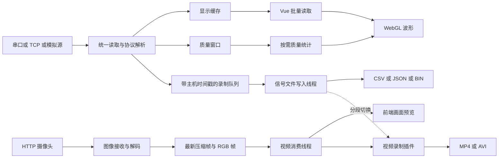

# 系统架构与运行状态

Serial Brain 需要在同一应用中处理持续输入的八通道信号、交互式波形、网络摄像头和本地文件录制。这些任务具有不同的速度与生命周期：设备输入不能依赖页面是否可见，绘图可以暂停，录像需要自行维护编码节奏，磁盘写入也不能由每次界面更新直接驱动。

系统将长时间运行的任务放在 Rust 线程与原生插件中，由 Vue 页面发出控制命令、读取状态或订阅事件。其核心组织方式是共享运行状态加独立数据队列。

## 分层与职责

前端通过 Tauri `invoke` 调用命令，通过事件接收摄像头画面及状态通知。应用没有独立的业务 HTTP 服务端；信号 TCP 监听器与摄像头 HTTP 客户端是设备数据通道。

- Vue 层负责视图切换、绘图、交互和录制流程编排。跨页面配置保存在模块级 `ref`、`reactive` 对象中。
- Rust 应用层负责设备读取、协议解析、缓存、质量统计、信号文件写入、摄像头拉流和 mDNS。
- `tauri-plugin-record-stream` 封装视频编码和画面检测，在桌面端使用 Rust OpenCV，在 Android 使用 Kotlin OpenCV。
- `tauri-plugin-android-forward-service` 提供 Android 前台服务的启动与停止，桌面实现为空操作。

初始化由 [lib.rs](../../src-tauri/src/lib.rs) 的 `run` 完成：创建 `Arc<AppState>`，注册插件，将状态放入 Tauri 管理容器，并将 `AppHandle` 保存到共享状态，供录制线程发送分段通知。

## 两条数据链路

信号数据先转换为 `[f32; 8]`，再分别写入显示、质量和录制缓冲区。前端波形使用批量拉取，不依赖逐样本的 `serial_data` 事件。摄像头则持续接收压缩图像，将最新画面提供给预览和录制；网络线程不为预览保存完整帧历史。

这两条链路没有共同的设备时钟。信号录制记录主机壁钟时间，视频通过固定帧率编码；共同文件名用于定位同一录制分段，不能直接提供精确的跨模态对齐关系。

## 运行状态的所有权

[state.rs](../../src-tauri/src/state.rs) 将状态拆成六个部分。

| 状态 | 持有的资源 | 对运行行为的影响 |
| --- | --- | --- |
| `CommunicationState` | 串口发送通道、`AppHandle` | 将发送请求交给读取线程，并允许后台发送事件 |
| `BufferState` | 两个样本队列及锁 | 保存最近样本，提供取出后清空的显示数据 |
| `SignalQualityState` | 500 个样本的窗口、八个质量标志 | 独立于绘图数据的消费，按需重新计算质量 |
| `StreamState` | 信号与摄像头运行标志、线程句柄、模拟开关、默认 URL | 分别控制两种采集任务 |
| `RecordingState` | 带时间戳的样本队列、文件句柄、线程句柄、信号和视频录制标志 | 分离数据进入队列、写盘和视频编码 |
| `MdnsState` | 发布器、服务句柄、发现结果 | 保存局域网服务生命周期与设备缓存 |

状态的生命周期跟随应用进程。页面卸载不会自动销毁这些 Rust 资源，进程退出后也不会自动恢复其内容。

## 四种运行状态必须区分

信号采集、波形刷新、摄像头拉流和文件录制可以分别启停。

| 操作 | 直接改变的状态 | 后续行为 |
| --- | --- | --- |
| 连接信号源 | Rust `signal_stream_running` | 启动读取线程，解析收到的数据 |
| 暂停波形 | 前端 `isRunning` | 暂停拉取显示数据，采集和录制仍可继续 |
| 启停摄像头 | Rust `camera_stream_running` | 控制图像接收与消费线程 |
| 启停信号录制 | Rust `recording_active` | 控制录制队列接收样本和写盘循环 |
| 启停视频录制 | Rust `video_recording_active` 与插件内部状态 | 控制是否向编码器提交 RGB 帧 |

`get_app_state` 提供分类查询及面向页面的组合结果。其中 `recording.status.isRecording` 和 `streaming_view.state.isRecording` 均为“信号录制或视频录制正在运行”。需要区分两种录制时，应读取独立字段，不能将组合布尔值直接解释为视频编码器状态。

`get_app_state("buffer", "data")` 具有消费副作用：返回待显示样本后清空队列。它与其他只读状态查询的语义不同。

## 线程与同步模型

主运行标志使用 `Arc<AtomicBool>`，访问采用 `SeqCst`。复合对象及可变队列使用 `Mutex`。锁保护单个资源，不会将“多个标志、文件、线程和插件状态同时切换”自动变成原子操作。

信号源切换通常执行以下顺序：清除旧运行标志、取出旧线程句柄并 `join`、创建新读取器、设置运行标志、启动线程。该方式保证普通切换路径先结束旧信号线程，再启动新线程。

摄像头真实流分为生产者和消费者。共享状态只保存生产者句柄；消费者句柄被放弃保存，依靠同一个运行标志退出。因此停止函数只等待生产者，不提供“两个线程均已退出”的完整确认。

信号录制的停止逻辑也未等待写入线程完成。其尾部写入和再次启动之间的关系见[信号录制与分段协同](05-signal-recording-segmentation.md)。

## 命令返回与任务就绪

[commands.rs](../../src-tauri/src/commands.rs) 的连接命令在启动线程后返回，真正打开串口或绑定 TCP 端口发生在 `reader_loop` 的 `setup` 中。因此命令返回成功表示线程已创建，不等价于设备已连接或已收到有效样本。

读取器初始化失败或读循环异常退出时，当前实现没有统一清除 `signal_stream_running`。状态查询主要反映控制标志，不能独立证明线程健康。TCP 是否有客户端连接，还由 `socket_status` 文本中的连接和断开消息辅助表达。

摄像头启动同样先设置运行标志，再异步建立 HTTP 连接。网络连接状态、是否有新画面以及录制器是否成功打开，需要分别理解。

## 页面切换与状态恢复

[App.vue](../../src/App.vue) 使用 `v-if` 挂载当前页面，没有用 `KeepAlive` 保持所有视图。切换页面后，组件的局部状态与监听器会重新创建；模块级状态及 Rust 后台任务继续存在。

前端恢复采用两种方式：

1. [appState.ts](../../src/store/appState.ts) 保存共享配置、波形历史和摄像头 URL 等会话内状态。
2. 页面挂载时调用 `get_app_state`，重新读取连接或录制标志。波形页面会把绘图开关重置为暂停。

组件局部状态并不全部由后端恢复。例如录制页面的 `isServiceRunning` 只记录该组件是否启动过 Android 服务，切换页面后会重新初始化。这类局部标志不能作为原生资源生命周期的唯一依据。

## 当前入口与未接入的实现

当前主界面使用 `RecordView.vue`，文件检查使用 `FileInspectView.vue`。`RecordingView.vue` 是另一套未挂载的录制页面，包含较多文件监听及轮询逻辑，不代表当前主流程。

`FilterConfigView.vue` 未挂载，保存操作仅输出前端配置，Rust 读取链路也未调用滤波器。`sci-rs` 依赖声明不构成已接入的信号处理功能。`offscreenWorker.ts` 为空文件，当前波形处理和绘制仍在 WebView 主线程执行。

## 关键源码

- [lib.rs](../../src-tauri/src/lib.rs)：插件注册、共享状态创建和命令入口。
- [state.rs](../../src-tauri/src/state.rs)：资源所有权、锁和运行标志。
- [commands.rs](../../src-tauri/src/commands.rs)：任务启动停止及组合状态查询。
- [App.vue](../../src/App.vue)、[appState.ts](../../src/store/appState.ts)：页面生命周期及会话内共享状态。
