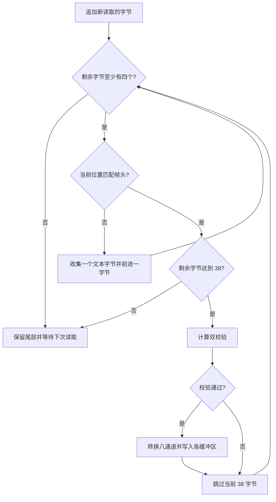

# 信号采集与二进制协议

串口和 TCP 都以任意长度的字节块交付数据，一次读取可能包含多个数据包，也可能只有一个包的部分内容。设备还可能在同一通道输出文本信息。信号采集模块通过统一读取器和有状态解析缓冲区，将这些输入转换为固定的八通道样本。

核心实现位于 [reader.rs](../../src-tauri/src/reader.rs)。`DataReader` 负责设备差异，`reader_loop` 管理读取生命周期，`process_buffer` 完成帧识别和数据分发。

## 统一读取接口

`DataReader` 只有三个操作：`setup` 初始化、`read_data` 返回字节数组、`close` 释放资源。三种读取器输出相同的二进制协议，后续解析逻辑不区分来源。

### 串口读取器

`SerialBinaryReader` 使用指定的端口、波特率、数据位、停止位和校验方式打开设备。读取超时为 100 ms，每次最多读取 1024 字节。超时视为本轮没有数据；其他读取错误结束循环。

发送方向通过 `mpsc::channel<String>` 交给同一个读取线程。在每次读操作前，线程尝试取出一条待发消息，再调用 `write_all`。因此 `send_serial` 成功表示消息进入发送通道，不表示设备确认接收；消息编码为字符串的 UTF-8 字节，写入结果也没有返回给命令调用方。

### TCP 读取器

`SocketBinaryReader` 是本机 TCP 服务端。`connect_socket` 中的 `host` 和 `port` 是监听地址，不是远端设备地址。默认前端配置为 `0.0.0.0:8083`。

监听器与已接受连接都设为非阻塞模式。没有客户端时，尝试 `accept`，遇到 `WouldBlock` 后休眠 10 ms；有客户端时，每次最多读取 1024 字节。实现同时只保存一个客户端连接。

对端正常关闭、读取返回零字节时，释放该连接并继续等待下一个客户端。其他读取错误会返回给 `reader_loop` 并终止整个读循环。已连接但暂时没有数据的路径没有休眠，可能形成高频空轮询。

前端“自动重连”通过重试 `connect_socket` 重建本地监听任务；它不是对远端信号设备的主动连接，也不替代读取线程中的接收状态管理。

## 数据帧布局

一个有效数据帧固定为 **38 字节**。字段顺序如下，所有通道值均采用小端序。

| 字节偏移 | 长度 | 含义 |
| --- | --- | --- |
| `0..3` | 4 | 固定帧头 `AA FF F1 20` |
| `4..35` | 32 | 八个有符号 `i32` 通道值，按通道 0 到 7 排列 |
| `36` | 1 | 前 36 字节的累加校验 `SC1` |
| `37` | 1 | 前 36 字节的累计和校验 `SC2` |

通道 `j` 的四字节字段起始于 `4 + 4j`。帧中没有采样率、设备时间戳、样本序号、可变通道数或协议版本字段。设备发送方与应用必须预先一致地约定这些固定布局。

### 双校验算法

令 `b[0]` 至 `b[35]` 为帧头及通道数据的字节，算法为：

```text
SC1 = (b[0] + b[1] + ... + b[35]) mod 256

prefix = 0
SC2 = 0
对每个 b[i]，按顺序执行：
    prefix = (prefix + b[i]) mod 256
    SC2 = (SC2 + prefix) mod 256
```

第二项也可写为 `Σ((36-i) × b[i]) mod 256`。两个校验均包含帧头，不包含末尾的校验字节。它们用于识别传输损坏，不提供样本丢失检测；缺少序号意味着接收端不能由连续的有效帧判断中间是否遗漏了整帧。

### 数值转换

解析 `i32` 后，先转换为 `f32`，再按以下比例换算：

```text
sample[j] = float32(raw[j]) × 0.5364 ÷ 12
          ≈ float32(raw[j]) × 0.0447
```

例如原始值 `1200` 对应约 `53.64`，原始值 `-1200` 对应约 `-53.64`。比例在代码中固定，没有随设备或增益配置变化的校准参数。输出的物理单位需要与设备侧定义核对，协议本身不携带单位。

转换结果成为 [types.rs](../../src-tauri/src/types.rs) 定义的 `ChannelData = [f32; 8]`。绘图、质量统计和录制均消费这个结果；当前文件不保存换算前的原始 `i32`。

## 半包、粘包与文本分流

`reader_loop` 保留一个跨多次读取的 `Vec<u8>`。每次有新字节时追加到末尾，再调用 `process_buffer`。



一轮扫描后只删除已经处理的前缀。完整帧之后的不足四个字节会留在缓冲区，从而允许帧头跨读取边界；匹配到完整帧头但数据不足 38 字节时，也保留整个未完成帧。

未匹配到帧头的字节集中用 GBK 解码，并通过 `serial_info` 事件发送。有效样本同时发送 `serial_data` 事件，不过主波形组件实际使用缓存查询接口读取数据。

校验失败时，解析器按 38 字节整体前进，没有在该候选帧内部逐字节重新搜索帧头。如果噪声恰好包含伪帧头，随后真正的帧头位于这 38 字节内，可能被一并跳过。末尾不足四字节的文本，以及跨两次解码拆开的 GBK 字符，也没有独立的文本流重组机制。

## 模拟源如何复用真实链路

`FakeBinaryReader` 先计算目标数值，再执行比例换算的逆运算，将结果转回 `i32`，组成带相同帧头和校验的 38 字节数据。这样模拟源也会经过真实解析器、校验逻辑和缓存分发。

生成器支持正弦、方波、三角波、锯齿波和随机值。各通道相位差为 `0.2` 个周期，目标幅度由 `min_value` 与 `max_value` 决定。有效通道数小于八时，其余通道填零。

配置中的 `frequency` 控制每次产出后的等待时间：`round(1000 / frequency)` 毫秒。它不是波形的振荡频率。生成器每个样本固定执行 `t += 0.001`，因此在实际样本率为 `Fs` 时，周期波形的理论频率为 `0.001 × Fs` Hz。例如理想的 500 样本/秒对应约 0.5 Hz。

等待时间未扣除计算与调度开销，模拟源不提供精确定时保证。通道数应限制在 1 至 8：生成循环使用了截断值，但补零循环使用原始 `channel_count`，传入零会产生不符合预期的帧长度。

## 设备接入约束

信号源必须发送固定八通道布局并使用相同校验规则。不同采样率不会改变协议，但会改变缓存可覆盖的时间和波形窗口的实际时长。若需要精确分析丢包、采样抖动或设备间同步，需要在协议与后续数据模型中显式表达序号和设备时间。

读取器启动失败通过 `socket_status` 报告，命令层并不等待 `setup` 成功。切换数据源时只停止旧读取任务，没有清空显示、质量和录制队列；旧源尾部数据可能与新源初始数据共同出现在现有缓存中。

## 关键源码

- [reader.rs](../../src-tauri/src/reader.rs)：`DataReader`、三个读取器、`compute_checksum`、`process_buffer`、`reader_loop`。
- [commands.rs](../../src-tauri/src/commands.rs)：`connect_serial`、`connect_socket`、`start_fake_data`、`stop_data_acquisition`。
- [types.rs](../../src-tauri/src/types.rs)：固定通道类型与模拟源配置。
- [SignalConfigView.vue](../../src/components/views/SignalConfigView.vue)：数据源启动与前端重试路径。
