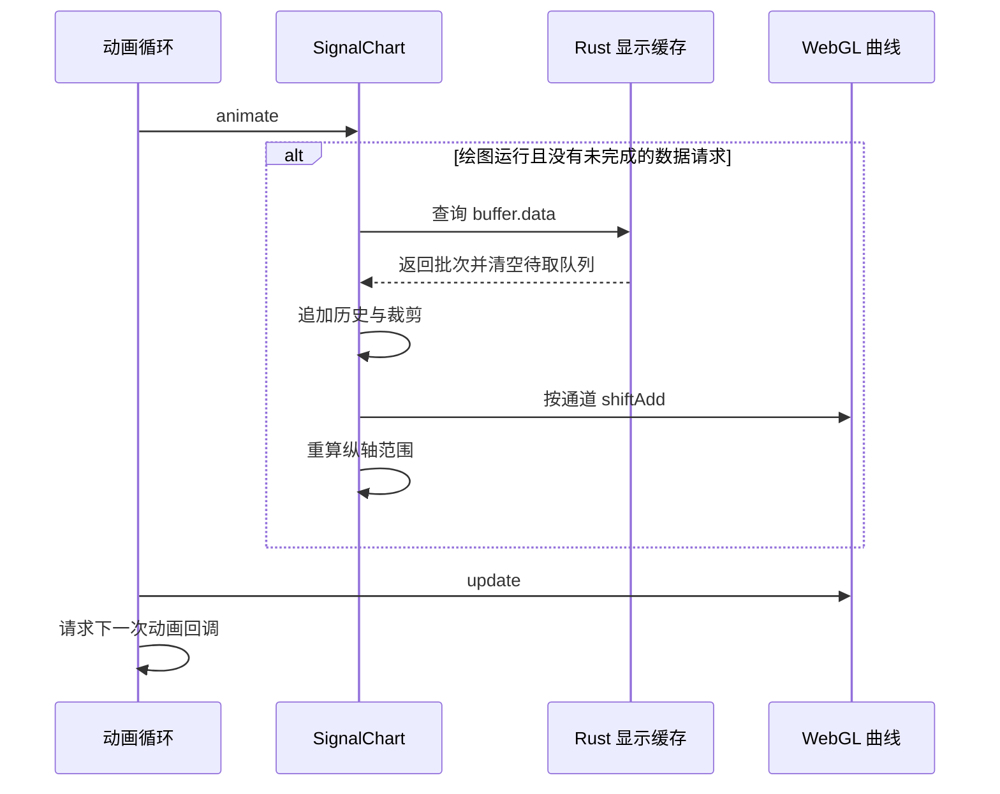

# 实时波形渲染与交互

实时显示八通道数据，需要同时处理持续追加的样本、有限的显示窗口、自动纵轴范围和交互坐标转换。逐样本更新 Vue 节点会将通信与界面渲染紧密耦合，难以控制刷新成本。

当前实现使用批量拉取、固定长度 WebGL 曲线和独立 Canvas 坐标轴。主要计算仍在 WebView 主线程执行，GPU 负责曲线绘制；这不是后台 Worker 驱动的绘图系统。

## 组件与数据所有权

[SignalPlottingView.vue](../../src/components/views/SignalPlottingView.vue) 控制绘图启停；[SignalVisualization.vue](../../src/components/signals/SignalVisualization.vue) 连接曲线、通道颜色、可见性、游标值和质量标志；[SignalChart.vue](../../src/components/signals/SignalChart.vue) 负责缓存增量、WebGL 对象和交互计算。

历史样本保存在 [appState.ts](../../src/store/appState.ts) 的 `chartDataBuffer`，窗口长度默认 5000。通道颜色和可见性保存在 [channelSettings.ts](../../src/components/signals/channelSettings.ts) 的模块级响应式数组中。它们可以跨组件重新挂载保留，但不持久化到磁盘。

## 批量读取与动画循环



`dataUpdatePending` 保证同一个曲线组件最多有一个未完成的数据查询。数据获取通过 Promise 异步完成，动画循环可以先绘制上一批数据；新批次到达后更新曲线，再由后续动画回调显示。

暂停按钮仅修改前端 `isRunning`，使 `refreshData` 停止请求数据。`wglp.update()` 仍可执行，游标等交互无需等待设备数据。后端采集和录制不受这个按钮直接控制。

## 从行数据到固定长度曲线

后端返回的每一行是一个八通道样本。`addNewDataPoints` 为八个通道分别创建 `Float32Array`，将行数据转置为通道数组，再调用对应曲线的 `shiftAdd`：旧点向左移动，新点追加在右侧，曲线总点数保持为 `windowSize`。

历史队列保留最近样本。重建曲线时，`fillLinesWithExistingData` 取最后 `windowSize` 行；如果历史不足，左侧用第一个真实样本的值填充。填充区域只是视觉延伸，不代表实际采集到更多样本，游标查询该区域时返回零值。

输入批次大小由后端待取队列决定，前端没有基于像素宽度做降采样。缩小绘图窗口不会降低设备采样量，也不会减少信号录制中的样本数。

## 显示坐标与纵轴自适应

WebGL 曲线横坐标通过 `arrangeX()` 在标准化范围内排列。纵坐标保留换算后的通道值，由全局比例和偏移映射到画布。

每次收到新批次，`updateMinMax` 遍历最近 `windowSize` 个样本，只统计可见通道。设最小值为 `min`、最大值为 `max`：

```text
range = max(0.001, max - min)
margin = 0.05 × range
yMin = min - margin
yMax = max + margin

effectiveRange = max(0.001, yMax - yMin)
gScaleY = 2 / effectiveRange
gOffsetY = -(yMin + yMax) / 2 × gScaleY
screenY = dataY × gScaleY + gOffsetY
```

上下各保留 5% 的幅度余量，最小范围约束用于避免常量信号导致除零。没有可见通道时，使用 `[-1, 1]` 作为基础范围。

隐藏通道立即改变曲线可见性，但纵轴范围在下一次新数据更新时才重新计算。暂停状态下仅切换通道可见性，纵轴可能保留原范围。

## 独立坐标轴与像素密度

曲线使用一个 WebGL Canvas，横轴和纵轴各使用一个 2D Canvas。实际像素尺寸为 CSS 尺寸乘 `devicePixelRatio`，以适配高密度屏幕。图高由容器宽度除以三得到。

横轴显示窗口内的样本索引，不是秒或主机时间戳。当前曲线数据也不保存时间列，因此横轴不能显示采集暂停、网络停顿或被缓存丢弃的时间间隙。

## 游标反变换

鼠标位置首先由 CSS 像素换算到 Canvas 像素，再映射为标准化坐标：

```text
rawX = 2 × relativeX - 1
rawY = 1 - 2 × relativeY

dataX = (rawX - gOffsetX) / gScaleX
dataY = (rawY - gOffsetY) / gScaleY
```

反变换可以在缩放后得到原始绘图区间的位置。游标对应样本使用以下近似索引：

```text
canvasIndex = round((dataX + 1) / 2 × (windowSize - 1))
padding = max(0, windowSize - 实际窗口样本数)
dataIndex = canvasIndex - padding
```

索引落在补齐区域或实际数据之外时，返回八个零。游标没有在两个样本之间进行插值。通道卡片显示游标所在位置的值，不是始终显示最后一个样本，也不是通道的平均值。

鼠标移动更新游标采用 10 ms 节流；每次纵轴比例更新也会重设游标，因此这个间隔只限制鼠标移动处理路径。

## 横向区间缩放

鼠标左键拖动得到数据坐标中的两个端点 `a` 和 `b`，释放后设置：

```text
gScaleX = 2 / abs(b - a)
gOffsetX = -(a + b) / 2 × gScaleX
```

选中区间由此映射到整个画布。双击恢复 `gScaleX = 1`、`gOffsetX = 0`。缩放只改变渲染变换，没有修改历史队列，也没有重新请求更早的数据。

触摸路径能够记录选择起点并更新矩形，但 `touchEnd` 只清除选择状态，没有执行鼠标释放时的比例计算。因此当前触摸选择不具备与鼠标拖动相同的缩放完成行为。

## 性能与生命周期边界

WebGL 降低了曲线绘制成本，但每个数据批次仍有 CPU 工作：行列转置、曲线点移动、历史裁剪、可见窗口最值扫描以及坐标轴重绘。最值扫描量随窗口长度和可见通道数增长，约为 `O(windowSize × channels)`。当前没有按像素聚合、极值包络或分层历史索引。

`MAX_BUFFER_SIZE` 在组件初始化时读取 `isSmallScreen`。该值初始为 `false`，Android 平台判断发生在挂载后的异步回调中；因此声明虽然包含 Android 为 5000 的分支，当前实际初始化常量为 20000，不会随平台结果自动改变。

调整窗口大小和画布尺寸会重新创建 `WebglPlot` 及曲线。卸载时取消动画并移除窗口 resize 监听，但实现没有显式释放旧 WebGL 图形资源。组件中存在 `onActivated`、`onDeactivated` 处理，当前应用入口实际通过 `v-if` 切换页面，不使用 `KeepAlive`。

清空波形只清除前端历史并重建曲线，不清空 Rust 待取队列。因此采集仍运行时，下一次刷新可能重新出现清空前尚未取出的样本。

质量查询的触发条件并未形成预期的每 30 帧降频，具体原因见[数据缓存与信号质量](03-buffering-signal-quality.md)。`offscreenWorker.ts` 目前为空文件，不能将主线程计算成本归入后台线程。

## 关键源码

- [SignalChart.vue](../../src/components/signals/SignalChart.vue)：`refreshData`、`addNewDataPoints`、`updateMinMax`、`updatePlotScale`、指针坐标及缩放逻辑。
- [SignalVisualization.vue](../../src/components/signals/SignalVisualization.vue)：通道状态与游标结果传递。
- [SignalPlottingView.vue](../../src/components/views/SignalPlottingView.vue)：绘图启停与页面重新进入后的状态。
- [appState.ts](../../src/store/appState.ts)、[channelSettings.ts](../../src/components/signals/channelSettings.ts)：跨页面历史与显示配置。
