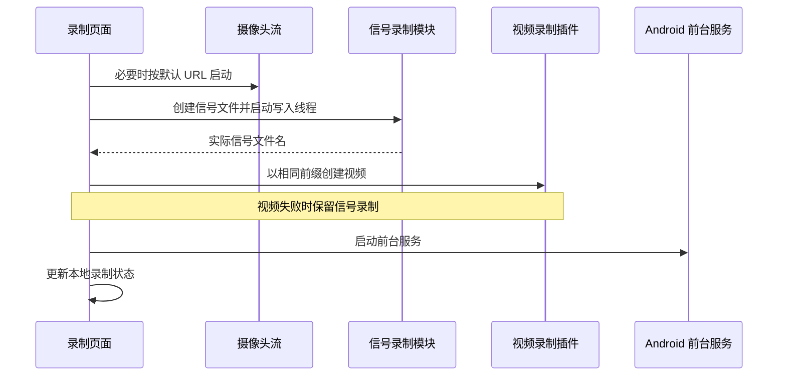

# 信号录制与分段协同

长时间采集需要持续写盘，并将过大的文件拆成多个可管理的片段。录制还必须独立于波形页面运行，且允许摄像头失败时继续保存信号。

当前实现由前端编排首次启动，Rust 独立线程负责信号写入和后续分段。信号与视频共享文件名前缀，但启动、停止和编码分别执行，不构成带统一时钟的原子录制会话。

## 首次启动流程

当前入口为 [RecordView.vue](../../src/components/views/RecordView.vue)。默认目录由前端创建为系统文档目录下的 `signal_data`，再将绝对路径传给 Rust。



没有默认摄像头 URL 或启动摄像头失败时，流程仍会尝试录制信号。视频启动失败也不回滚已经启动的信号录制。系统允许存在只有信号文件的片段。

前端按钮依据信号连接状态禁用，但 Rust `start_recording` 本身不检查信号线程是否收到数据。录制标志开启并不保证文件中已存在有效样本。

## 文件创建与写入线程

[recording.rs](../../src-tauri/src/recording.rs) 的 `start_recording` 使用 Unix 毫秒时间生成文件名：

```text
serial_recording_<毫秒时间戳>.csv
serial_recording_<毫秒时间戳>.json
serial_recording_<毫秒时间戳>.bin
```

文件以创建、写入、截断模式打开，不采用追加模式。Rust 不负责创建传入的目录；当前主界面在启动前完成目录准备。

开始后设置 `recording_active`，写入 CSV 表头或 JSON 起始括号，再启动写入线程。线程循环先检查是否需要分段，然后通过 `get_recording_data` 将队列当前内容全部取出，并根据保存的格式写入文件。

- 队列为空时休眠 10 ms。
- 写入一批后休眠 5 ms。
- CSV 每批调用 `flush`；JSON 和二进制批次没有相同的显式刷新操作。
- 写入对象是普通 `File`，没有额外使用 `BufWriter`。

这些间隔控制队列轮询，不是采样时钟。采样时间在样本入队时已经生成，不能用写入循环间隔解释信号采样率。

## 存储格式

三种格式保存同一种信息：主机 Unix 微秒时间戳与八个已换算通道值。它们均不包含源设备标识、实际采样率、单位、校准参数或独立会话编号。

### CSV

表头固定为：

```csv
timestamp,channel_0,channel_1,channel_2,channel_3,channel_4,channel_5,channel_6,channel_7
```

每行对应一个样本，首列是十进制微秒时间戳，其余为八个 `f32` 数值的文本表示。通道字段从零开始命名，界面通道标签从一开始显示，两者只是编号方式不同。

### JSON

文件是一个 JSON 数组，单条记录包含 `timestamp` 和 `values`：

```json
[
  {"timestamp": 1760000000000000, "values": [1.0, 2.0, 3.0, 4.0, 5.0, 6.0, 7.0, 8.0]}
]
```

以上数值用于说明格式。`first_json_entry` 决定记录前是否添加逗号；文件只在停止或分段时补上闭合括号。因此正在写入的 JSON 文件通常不是完整 JSON 文档，不能要求普通整文件解析器随时成功读取。

### 二进制

二进制文件没有全局文件头，也不保存设备的 38 字节输入帧。每条记录使用小端序，布局如下：

| 记录内偏移 | 长度 | 类型与内容 |
| --- | --- | --- |
| `0..7` | 8 | `u64` Unix 微秒时间戳 |
| `8..11` | 4 | `u32` 通道值数量，当前固定为 8 |
| `12..75` | 64 | 八个 `f64` 通道值 |

当前记录长度为 `8 + 4 + 8 × 8 = 76` 字节。通道数据在写入前已经是 `f32`，转换成 `f64` 保存不会恢复此前损失的精度。

在理想的 500 样本/秒输入下，仅记录载荷为 `76 × 500 = 38000` 字节/秒。读取程序应检查每条记录的计数字段和剩余字节，避免将中断写入形成的残缺尾记录当成完整数据。

## 分段轮换

`max_duration_minutes` 控制单个片段的壁钟时长。线程使用 `SystemTime::now().duration_since(segment_start_time)` 判断，只有 `elapsed > max_duration` 才轮换，因此边界会受轮询、调度和其他工作影响。

`handle_segment_rotation` 按以下顺序工作：

1. 为旧 JSON 写闭合括号，并刷新旧文件。
2. 按当前时间生成新文件名，创建新文件并写入格式起始内容。
3. 替换共享文件句柄及 `recording_filename`。
4. 发送 `recording-file-changed` 和 `recording-filename-changed`。
5. 停止当前视频录制，等待 500 ms，再以新前缀启动视频。
6. 重置 JSON 首条记录状态及片段开始时间。

轮换发生在同一个信号写入线程中。视频停止、500 ms 等待和重新启动期间，信号采集仍可以向独立队列追加数据，但写盘线程暂时不消费它。500 ms 在理想 500 样本/秒下相当于约 250 个待写样本；更长的原生编码操作会进一步增加积压。

分段检查先于取出队列数据，因此新文件中可能包含轮换前已经入队的样本。片段归属由写入时选中的文件决定，没有严格依据每个样本时间戳划分固定时间区间。

## 自动轮换与前端选项

后端参数 `_auto_start` 当前未使用。达到片段时长后始终尝试创建下一个片段，而不是根据界面的自动开始选项决定继续或停止。录制会持续到显式停止或错误路径结束。

前端仍监听 `recording-completed`，并保留收到该事件后重新启动录制的逻辑；当前后端没有发送该事件。实际分段由 Rust 内部完成，前端通过文件名变化事件更新显示。

## 信号与视频的关联规则

首次启动视频时，前端删除信号文件名最后一个扩展名，再添加 `.mp4`。例如：

```text
serial_recording_1760000000000.csv
serial_recording_1760000000000.mp4
```

这种同名前缀关系允许文件索引查找伴随视频，但没有记录视频首帧相对信号首样本的偏移。真实流消费者还可能重复最后一帧，编码器也具有自己的帧率调度。不能将第 `n` 个视频帧直接等同于某个固定的信号样本编号。

分段时的前缀处理与首次启动不同：后端使用格式参数删除扩展名。二进制格式参数为 `binary`，实际扩展名为 `.bin`，因此轮换可能得到 `serial_recording_<时间>.bin.mp4`。文件索引按去掉 `.bin` 后的 `.mp4` 查找时，无法匹配这种命名。

视频轮换无条件进入停止与启动流程，没有保存“本次信号录制是否选择了视频”的独立会话配置。当摄像头正在运行时，后续片段可能重新尝试启动之前没有成功的视频。

## 停止与文件完成语义

主界面依次停止信号录制、尝试停止前台服务、再停止视频。它不会自动停止信号采集，也不会在当前 `RecordView` 路径中停止摄像头流。

后端信号停止先在调用线程中补 JSON 结束括号，再将运行标志置为假，取走写入线程句柄并清空共享文件句柄。这里没有 `join`，也没有在返回前排空录制队列。因此停止命令返回不表示所有已入队样本都已写入文件。

写入线程本身也有 JSON 结束与文件清理逻辑。两个结束路径之间没有统一的完成握手；在特定线程交错下，可能出现闭合后继续写入、重复闭合或尾部样本未保存。快速停止后重新开始时，旧线程还可能访问新的共享文件状态。

再次调用 `start_recording` 时，文件创建和共享句柄替换发生在检查 `recording_active` 之前。当前接口并非幂等启动操作，录制期间重复启动可能替换文件，但不会重新初始化写入线程和格式头。

## 文件错误与时间精度

批次写入错误通常只输出日志，没有统一转为录制失败事件。新分段文件创建失败时，后续文件名通知和视频轮换仍继续执行；事件中的目标文件名不能独立证明新文件创建成功。

信号时间戳表示主机入队时间，壁钟调整会影响分段时长判断。文件名使用毫秒、记录使用微秒、视频使用帧序列，这三者需要分别处理。当前实现适合按文件关联采集片段，不提供严格的同步录制或崩溃后完整性保证。

## 关键源码

- [recording.rs](../../src-tauri/src/recording.rs)：启动、停止、写入循环、分段及三种格式序列化。
- [state.rs](../../src-tauri/src/state.rs)：录制队列和时间戳生成。
- [RecordView.vue](../../src/components/views/RecordView.vue)：首次联合启动、默认目录和停止顺序。
- [commands.rs](../../src-tauri/src/commands.rs)：视频录制状态门控。
- [streaming.rs](../../src-tauri/src/streaming.rs)：供分段线程调用的同步视频启动停止包装。
