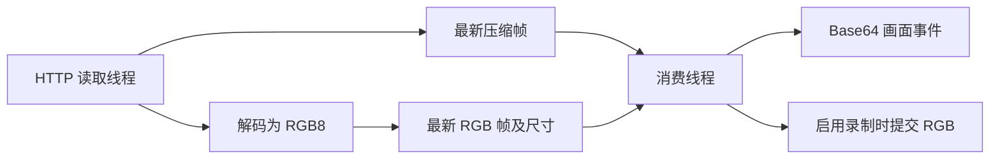

# 摄像头流与局域网发现

摄像头的数据接收速度会受到网络抖动影响，而预览与录像希望持续获得画面。系统使用局域网服务发现定位摄像头，以 HTTP 分段图像流接收压缩帧，再通过最新画面缓存将网络读取和画面消费分离。

核心由 [mdns.rs](../../src-tauri/src/mdns.rs)、[streaming.rs](../../src-tauri/src/streaming.rs) 和 [StreamingView.vue](../../src/components/views/StreamingView.vue) 组成。当前真实流实现面向带长度字段的 HTTP multipart 图像流，不是通用视频解码器。

## mDNS 发布与发现是两个方向

### 发布本机服务

`connect_socket` 启动信号 TCP 读取器时，会调用 `start_mdns_service`，使用 `libmdns` 发布：

```text
实例名：petbrain
服务类型：_iot._tcp
TXT：info=petbrain app
发布端口：8080
```

发布器及服务句柄保存在 `MdnsState`，通过保留这些对象维持发布。另有线程每 25 秒检查活动标志并输出状态。停止信号采集时，如果服务仍活动，则释放服务和发布器。

发布端口在调用点固定为 8080，并未使用信号 TCP 的配置端口；前端 TCP 默认端口为 8083。因此当前发现信息不能直接视为信号监听器的准确地址。

用于状态展示的本机 IPv4，通过创建 UDP socket 并选择到 `8.8.8.8:80` 的本地路由获得，不发送业务数据；失败时回退为 `127.0.0.1`。在多网卡环境，这个状态地址不一定是摄像头所在网络的地址。

### 发现摄像头

`discover_streaming_devices` 使用 `mdns-sd` 浏览 `_iot._tcp.local.`。每次扫描先清空共享设备列表，再启动后台线程，在约三秒内处理解析结果。

只有满足以下条件的结果被加入列表：

- 服务解析结果包含 IPv4 地址，选取其中一个 IPv4。
- `get_hostname()` 返回的主机名转为小写后包含 `cam`。

这里的 `name` 来源于主机名，不是界面自定义名称。筛选不依赖 TXT 中的摄像头类型，也不是扫描所有 RTSP 或 HTTP 服务。

每发现一个匹配项，发送 `mdns_device_discovered`；扫描结束后发送 `mdns_devices_list` 并关闭发现 daemon。前端逐项事件按 IP 和端口去重，最终列表则直接采用后端结果。后端自身没有完整的去重与服务移除处理。

## 设备选择与 URL

设备选择默认构造 `http://<ip>:<port>/stream`，并将 URL 保存到 Rust `default_stream_url` 和前端共享状态。该配置仅保存在当前进程，没有持久化文件。

前端还会在扫描启动约四秒后读取发现缓存作为补充。扫描期间流状态变更、页面切换及异步结果回调没有统一的扫描代次编号。

`constructDeviceUrl` 保留了按服务类型生成 `rtsp://` 的分支，但真实流接收使用 reqwest HTTP 客户端，没有 RTSP 会话、RTP 解包或相应解码实现。不能将这个字符串分支解释为 RTSP 已受支持。

最终发现列表还可能重新选择第一个设备：如果当前 URL 不包含列表中的任何 `ip:port`，会覆盖现有选择。手动输入的 URL 也可能受到这一规则影响。

## HTTP 图像帧解析

真实流生产者为每次连接创建阻塞 HTTP 客户端，配置五秒请求超时，对 URL 执行 GET 并检查 HTTP 状态。

响应头中的 `Content-Type` 按分号拆分，查找 `boundary=` 参数；未找到时使用 `frame`。解析器在正文中按行寻找 `--<boundary>`，然后读取该片段的头部，取 `Content-Length`，再读取指定字节数的图像数据。

可接受的正文形态如下：

```text
--frame
Content-Type: image/jpeg
Content-Length: <图像字节数>

<恰好指定长度的图像字节>
--frame
...
```

单帧数据交给 `image::load_from_memory` 解码，成功后转为 RGB8。生产者分别更新压缩帧缓存和 RGB 帧缓存。

这个解析器有明确的格式约束：每帧需要可解析的 `Content-Length`；boundary 参数没有处理带引号的形式；没有通用的视频容器解复用、音轨处理或帧时间戳提取；分配帧缓冲区前也没有设置单帧长度上限。

## 最新画面缓存



每个缓存只有一个 `Option` 槽位，新画面覆盖旧画面。消费线程每轮处理后休眠 33 ms，读取当前缓存，发送 `frame` 事件，并在视频录制标志开启时提交 RGB 帧。

消费不会取走或清空缓存，因此网络没有新帧时，仍会重复发送和录制最后一幅画面。它以画面连续性换取了“每次消费都对应新摄像头帧”的语义。

33 ms 是每轮末尾的等待，不是精确的固定周期。Base64 编码、事件发送、图像分析及视频写入时间会叠加到实际周期中。

两个缓存分别加锁、分别更新，没有共用帧编号。压缩帧先更新，RGB 只有解码成功才更新，因此预览与录制可能短暂对应不同帧；解码失败时也可能出现压缩缓存更新而 RGB 仍停留在旧画面的情况。

消费端持锁执行 Base64 编码和插件调用，相应操作耗时会使生产者等待。最新槽位减少了应用层历史积压，但不表示整条链路没有复制或阻塞。

## 网络恢复与停止

连接失败、HTTP 状态错误、按行读取错误和帧体读取错误会进入重新连接路径，重试前通常等待 100 ms。没有指数退避或最大重试次数，最后画面缓存也不会在连接失败时清空。

正文按行读取只检查 `is_err()`，没有将 `Ok(0)` 作为流结束处理。如果服务端在片段之间干净关闭连接，空行分支可能持续循环，而不进入预期的重新连接流程。因此“读错误后重连”和“所有连接结束都自动恢复”不能等同。

停止时清除共享运行标志并等待生产者线程。正在阻塞的网络调用不会因标志改变立即中断，停止需要等待当前调用返回。消费线程没有保存可等待的句柄，停止函数不确认它已结束。

## 模拟视频与前端预览

模拟源生成 320 × 240 RGB 随机图像，每 30 次迭代在亮色和暗色区间切换。图像编码为 PNG 后发送，录制时直接提交生成的 RGB 数据。循环同样在每轮末尾休眠约 33 ms，不能据此认定严格的 30 fps。

前端接收 Base64 后创建 `Image`，绘制到两个 320 × 240 Canvas。隐藏 Canvas 当前没有将帧重新送回录制插件；真实录像使用 Rust 消费线程的 RGB 数据。

前端统一使用 `data:image/png;base64,` 前缀，而真实 HTTP 流保留的是源图像压缩字节，可能为 JPEG。当前事件没有携带实际 MIME 类型。预览还会固定缩放到 320 × 240，不保留任意源宽高比。

主开关通过 `toggleStreamingState` 启动时固定传入 `fake: false`；切换模拟开关的路径才会在已有流运行时按模拟标志重新启动。这两条启动路径的行为不同。

## 画面状态事件

`frame_analysis` 由视频插件处理帧后的结果取反得到：`!is_covered`。它只在视频录制开启并提交帧时产生，预览本身不会持续执行该分析。界面变量名 `isBrightEnough` 表达的是这个结果，实际算法是边缘数量阈值，详见[跨平台视频编码与画面检测](07-cross-platform-video-recording.md)。

## 关键源码

- [mdns.rs](../../src-tauri/src/mdns.rs)：发布、三秒发现窗口、主机名筛选与结果事件。
- [streaming.rs](../../src-tauri/src/streaming.rs)：multipart 解析、双槽位缓存、重试和模拟视频。
- [StreamingView.vue](../../src/components/views/StreamingView.vue)：设备选择、URL 构造、预览及独立录像。
- [appState.ts](../../src/store/appState.ts)：共享摄像头开关与 URL 同步。
