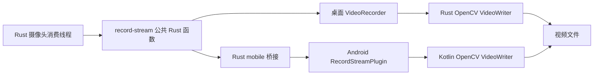

# 跨平台视频编码与画面检测

摄像头模块提供的是解码后的 RGB 图像，而视频文件需要固定尺寸、编码格式和帧率。桌面与 Android 的原生调用方式不同，图像字节还需要跨越 Rust 与 Kotlin 边界。

`tauri-plugin-record-stream` 以统一的启动、提交帧、停止和配置入口封装两种实现。插件同时执行基于图像边缘数量的遮挡启发式判断，再将结果返回给摄像头模块。

## 插件边界与调用路径

主应用并不依赖前端逐帧提交录像数据。正常链路为：



[lib.rs](../../tauri-plugin-record-stream/src/lib.rs) 通过 `cfg(desktop)` 与 `cfg(mobile)` 选择实现，并通过 `RecordStreamExt` 从应用管理状态取得插件实例。桌面 `VideoRecorder` 被 `Arc<Mutex<_>>` 包装，使启动、推帧和停止串行访问同一个编码器。

主应用还注册了 `push_video_frame` 命令，但现有预览组件不使用该命令回传 Canvas 图像。插件的 `guest-js` 包装仅提供 `ping`，录像主链路使用应用命令和 Rust 公共函数。

## RGB 帧契约与跨语言传输

提交帧包含 RGB8 字节数组、宽度和高度，调用方应提供恰好 `width × height × 3` 字节。尺寸、通道顺序与字节数共同定义图像，不能将 JPEG 或 PNG 压缩数据直接当作这个数组。

桌面端直接接收 `Vec<u8>`，构造三通道 OpenCV `Mat`，再从 RGB 转为 BGR。Android 路径先在 Rust 中将 RGB 编码成 Base64 字符串，经 `run_mobile_plugin("pushFrame", ...)` 传递，再由 Kotlin 解码并填充 `Mat`。

320 × 240 RGB 帧的原始数据为 230400 字节，Base64 为 307200 个字符，不计 JSON 和对象开销。预览用的压缩图像 Base64 与 Android 录像用的原始 RGB Base64 是两次独立传输。

启动参数也有桥接层转换：Rust 模型使用 `file_path` 字段并声明 camelCase 序列化，移动实现显式构造 `{"file_path": ...}`，对应 Kotlin 的 `optString("file_path")`。修改桥接参数时必须同时维护 Rust 实际 JSON 键与 Kotlin 读取键。

## 编码配置差异

| 项目 | 桌面实现 | Android 实现 |
| --- | --- | --- |
| 默认输出尺寸 | 320 × 240 | 320 × 240 |
| 默认编码帧率 | 20 fps | 30 fps |
| MP4 路径 | `mp4v` FourCC | 首先尝试 `H264` |
| AVI 路径 | `MJPG` FourCC | `MJPG` FourCC |
| MP4 编码失败 | 返回编码器错误 | 尝试改为同名前缀的 `.avi` 与 MJPG |
| `configure_record` | 返回成功，但不改变实际配置 | 更新宽度、高度和帧率字段 |
| 计时来源 | `Instant` | `System.currentTimeMillis()` |
| 停止时待写队列 | 不主动排空 | 将剩余队列写完后释放编码器 |

桌面启动入口固定传入 320、240、20.0；当前主应用没有调用配置入口。不能依据配置接口存在就认为两平台均使用任意分辨率和帧率。

Android 回退编码可能将请求的 `.mp4` 变为实际的 `.avi`，返回值只有 `success`，没有返回最终路径。上层文件索引只查找 `.mp4` 时，可能无法识别实际已经产生的 AVI 文件。

## Android 执行模型

Kotlin 在 `startRecord` 中创建单线程 `ExecutorService`，在该执行器上初始化 `VideoWriter`。后续 `pushFrame` 的解码、颜色转换、排队、写入和检测也提交给同一个执行器，避免把这些处理直接放在界面线程。

处理完成后通过 `Handler(Looper.getMainLooper())` 调用 `invoke.resolve` 或 `invoke.reject`。方法立即返回的空 `JSObject` 不代表编码初始化或帧处理已经完成，实际完成通过异步结果传回 Rust 桥接。

`stopRecord` 将关闭任务放入同一个执行器，处理前面已经排队的工作后再排空帧队列、释放 OpenCV 资源并关闭执行器。任务队列和帧队列均没有显式容量限制。

## 固定帧率调度

两套实现都维护以下状态：

- `frame_queue` 或 `frameQueue`：按到达顺序保存带时间的图像。
- `last_frame` 或 `lastFrame`：最后到达画面的副本。
- `next_frame_time` 或 `nextFrameTime`：下一个计划输出时刻。
- `frame_interval` 或 `frameIntervalMs`：由 `1000 / fps` 得到的整毫秒间隔。

每次提交图像时，先入队并更新最后画面，再调用队列处理函数：

```text
只要下一个计划时刻不晚于当前时刻：
    队列非空：取最旧一帧
    队列为空且有最后画面：复制最后画面
    将所选帧写给 VideoWriter
    计划时刻增加一个帧间隔
    如果仍落后超过一秒，将计划时刻跳到当前时刻之后
```

时间戳没有用于选择“最接近当前输出时刻”的帧，也没有作为显式 PTS 写入容器。算法本质上是 FIFO 加缺帧复制和时间节拍控制。

队列处理只在收到 `push_frame` 或 `pushFrame` 时被调用，没有独立的编码定时器。完全停止提交后，插件不会自行定时复制画面；真实摄像头消费线程持续提交最后画面，才使网络断流时仍有后续处理机会。

30 fps 对应的间隔被截断为 33 ms，而 `VideoWriter` 配置仍为 30 fps。这两个节奏不是完全相同的时间尺度，处理开销也会改变实际提交频率。

## 队列积压与视频时长

接收最新画面的单槽位和编码器 FIFO 解决的是不同问题。前者会覆盖旧图像，后者会保留尚未写出的每次提交。编码队列没有长度上限，也没有按帧龄丢弃旧图像的规则。

当实际提交率持续高于编码输出率时，积压量约按 `输入率 - 输出率` 增长。例如假定每秒持续提交 30 帧，而桌面按 20 fps 输出，理论上每秒多出约 10 帧；仅 320 × 240 三通道像素数据就约增加 2.3 MB。这个数值是容量推算，不是实际吞吐测量。

落后超过一秒时调整计划时刻，不会清空这些旧图像。桌面停止时不排空剩余帧，因此可能留下未编码尾部；Android 停止时把队列全部写入，而容器帧率仍保持原配置，因此积压可能增加最终播放时长。两端的“停止完成”语义不能互换。

视频内没有同步保存信号样本时间、摄像头原始采集时间或跨文件偏移。输出帧数除以编码帧率得到的是容器播放时长，不一定等于设备实际采集时长。

## 遮挡检测机制

插件将 BGR 图像转为灰度，执行 Canny 边缘检测，参数为低阈值 50、高阈值 150、孔径 3、`L2gradient = false`，再统计非零边缘像素。

```text
is_covered = edge_count < 500
```

该规则利用“缺少图像边缘可能意味着被遮挡”的特征，不直接测量亮度。平整背景、低纹理或模糊画面也可能得到低边缘计数，具有纹理的遮挡物则可能得到高计数。

两平台检测阶段不同：

- 桌面在原输入尺寸上做边缘检测，然后缩放到录像尺寸。
- Android 先缩放到配置尺寸，再经过可选图像效果，最后做边缘检测。

相同的固定阈值在不同尺寸和不同处理顺序下含义不同，不能要求两平台对所有画面给出一致结果。

Rust 摄像头模块收到结果后发送 `frame_analysis = !is_covered`，界面将它保存为 `isBrightEnough`。当前事件只在录制提交帧时产生，且调用方没有同时检查响应中的 `success` 字段。它不是持续的摄像头在线检测或亮度测量。

Android 实现还包含灰度、边缘、模糊及复古色效果，但 `setEffect` 没有接入当前 Rust 公共调用链及主界面，默认效果为关闭。

## 录制状态的一致性

主应用 `video_recording_active` 和插件 `is_recording` 是不同层的状态。`start_stream_recording` 检查插件返回的 `success` 再置位，而联合录制使用的 `start_video_recording` 把 `record_video_stream` 的任意 `Ok(_)` 都视为成功，包括 `Ok(false)`。

桌面内部 `start` 还会在确认编码器成功打开之前设置录制标志。初始化失败时，主应用和插件可能形成不同的状态。联合录制停止入口忽略插件停止错误并清除主应用标志，也不能作为视频已成功完成封装的独立证明。

因此录像状态判断需要区分命令是否成功返回、插件是否真正开始编码、是否持续收到帧以及停止是否完成。当前组合状态没有覆盖全部阶段。

## 关键源码

- [插件 lib.rs](../../tauri-plugin-record-stream/src/lib.rs)：公共 Rust 入口及平台分派。
- [desktop.rs](../../tauri-plugin-record-stream/src/desktop.rs)：`VideoRecorder`、图像转换、检测与 FIFO 调度。
- [mobile.rs](../../tauri-plugin-record-stream/src/mobile.rs)：Base64 传输及移动端调用参数。
- [RecordStreamPlugin.kt](../../tauri-plugin-record-stream/android/src/main/java/RecordStreamPlugin.kt)：Android 编码器初始化、回退、任务执行与关闭。
- [应用 commands.rs](../../src-tauri/src/commands.rs)：不同录像入口的状态更新规则。
