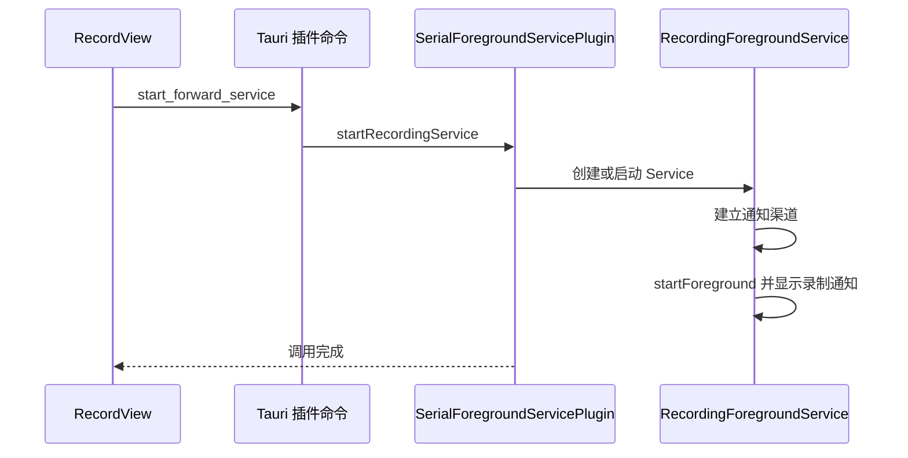

# Android 后台运行与原生集成

录制需要跨页面持续运行，并在应用进入后台时尽量保留原生处理任务。Android 版本在 Tauri 应用之外增加一个前台服务插件，同时将视频编码放入 Kotlin OpenCV 执行路径。

这里有三个不同的生命周期：WebView 页面、Rust 采集及写入任务、Android Service。前台服务提供进程运行期间的后台录制支撑，但服务本身不拥有信号读取器或文件写入线程，也不保存可恢复的录制会话。

## 原生边界

应用由生成的 Android 工程承载，`MainActivity` 继承 `TauriActivity`。Rust 入口带有 `tauri::mobile_entry_point`，插件初始化时再通过 `register_android_plugin` 绑定 Kotlin 类。

两个本地插件承担不同职责：

| 插件 | Rust 到 Kotlin 的边界 | 原生资源 |
| --- | --- | --- |
| `android-forward-service` | `startRecordingService`、`stopRecordingService` | Android Service 和常驻通知 |
| `record-stream` | `startRecord`、`pushFrame`、`stopRecord`、`configureRecord` | OpenCV Mat、VideoWriter、单线程执行器 |

录像插件的线程和资源在[跨平台视频编码与画面检测](07-cross-platform-video-recording.md)中说明。前台服务只管理通知与 Service 生命周期，不执行图像编码或信号协议解析。

## 前台服务启动路径

Kotlin 根据系统版本选择 `startForegroundService` 或 `startService`。Service 在 `onStartCommand` 中构造持续显示的录制通知，使用通知 ID 1，并返回 `START_STICKY`。

通知渠道 ID 为 `serial_brain_recording_channel`，重要级别设置为低。服务销毁时移除前台通知。插件清单将服务声明为不导出，类型为 `dataSync`，并声明 `FOREGROUND_SERVICE` 权限。

以上描述对应仓库现有调用与配置。`START_STICKY` 返回值不是采集会话恢复协议：即使服务重新创建，当前实现也没有序列化设备参数、当前文件、未写样本或视频编码进度的恢复逻辑。

## 何时启动和停止

当前 `RecordView` 在信号文件成功创建、视频录制尝试完成后调用前台服务。服务启动失败不会回滚信号录制，前端仍可能显示录制中。

停止时，页面先停止信号录制；只有局部 `isServiceRunning` 为真才调用服务停止，之后再停止视频。分段轮换由 Rust 线程执行，不重新启动前台服务。

独立视频录制入口位于 `StreamingView`，没有启动这个前台服务。因此不能把联合录制路径的后台行为直接推广到所有视频入口。

切换页面时，录制不会停止，但 `RecordView` 的局部 `isServiceRunning` 会随组件销毁而丢失。返回页面会重新读取 Rust 录制状态，却没有读取 Service 的真实状态；此时即使原生服务仍运行，本地标志仍可能为假，后续停止录制也可能跳过服务停止。

## 后台持续运行的实际范围

信号读取、信号写盘和摄像头接收使用原生线程，普通页面卸载不会终止它们。波形刷新依赖 WebView 的动画回调，页面被卸载后会停止绘图；这与信号是否继续采集是两回事。

前台服务实现中没有唤醒锁、网络状态锁或应用进程重建后的任务恢复逻辑。它也没有绑定 Rust 线程完成事件。现有代码不能提供屏幕关闭、系统调度或进程被回收后仍绝对连续的采集保证。

`SerialForegroundServicePlugin` 名称中的 Serial 不代表 Android USB 串口驱动。其 `SerialUtility` 只记录并返回字符串；实际串口读取仍来自主 Rust 模块的 `serialport`。当前插件没有 USB 设备枚举、授权和端点读写实现。

## Tauri 命令与能力配置

主应用在 [lib.rs](../../src-tauri/src/lib.rs) 注册应用命令和插件，在 [default.json](../../src-tauri/capabilities/default.json) 配置主窗口能力。

前台服务由前端通过 `plugin:android-forward-service|...` 直接调用，默认能力包含对应插件的默认权限，该默认权限列出启动与停止命令。

视频主链路则由应用 Rust 代码调用插件公共函数。主窗口能力没有列入 `record-stream:default`；即使添加该默认权限，其文件当前也只包含 `ping` 和 `start_record`，不包含全部推帧、停止和配置命令。因此新增前端直调插件路径时，需要同时核对调用入口和权限声明，不能仅以插件已注册判断前端可调用性。

文件管理通过 Tauri 文件系统插件访问文档目录与应用数据目录。信号写入使用 Rust `std::fs`，两条路径的权限检查位置不同。前端能枚举某目录与后端能否打开传入路径，需要分别按各自调用链判断。

## 原生依赖分流

[主 Cargo.toml](../../src-tauri/Cargo.toml) 通过本地路径引入两个插件。主 crate 中直接的 OpenCV 声明虽然已注释，桌面录像插件仍依赖 `opencv` crate，因此完整桌面应用仍需要满足该插件的原生 OpenCV 构建和运行条件。

[录像插件 Cargo.toml](../../tauri-plugin-record-stream/Cargo.toml) 对非 Android 目标启用 OpenCV 0.94.4，功能包括 `clang-runtime`、`imgcodecs`、`videoio` 和 `imgproc`。Android 路径不编译这项 Rust OpenCV 依赖，而在 [Gradle 配置](../../tauri-plugin-record-stream/android/build.gradle.kts) 中引入 `org.opencv:opencv:4.10.0`。

当前 Android 应用工程设置 `compileSdk = 34`、`targetSdk = 34`、`minSdk = 24`；录像库设置 `compileSdk = 34`、`minSdk = 21`。这些是仓库中的配置值，不代表所有目标系统上的行为已经被同一组录制测试覆盖。

插件构建脚本声明了 Android 和 iOS 路径，移动 Rust 文件也包含 iOS 条件绑定，但仓库没有相应 Swift 插件实现。现有代码不能据此描述为已经具备完整 iOS 原生录制链路。

## 构建入口与配置关系

前端构建由 `package.json` 的 `build` 执行 TypeScript 检查与 Vite 打包。Tauri 配置的开发和构建前置命令分别为 `pnpm dev` 和 `pnpm build`，产物目录指向 `dist`。

完整原生构建还包含 Rust 主 crate、插件 Rust 层，以及 Android 目标下的 Gradle/Kotlin 工程。仅前端打包成功不能验证 OpenCV 可用性、编码器打开、插件方法返回或前台服务行为。

仓库根 README 中的 OpenCV 环境变量示例带有具体机器路径，其用途是展示原生链接配置，不能直接作为跨平台统一配置。关键依赖边界应以主 crate、插件的条件依赖及 Android Gradle 声明共同确定。

## 关键源码

- [前台服务 mobile.rs](../../tauri-plugin-android-forward-service/src/mobile.rs)：Kotlin 类注册与原生命令转发。
- [SerialForegroundServicePlugin.kt](../../tauri-plugin-android-forward-service/android/src/main/java/SerialForegroundServicePlugin.kt)：Service 启停。
- [RecordingForegroundService.kt](../../tauri-plugin-android-forward-service/android/src/main/java/RecordingForegroundService.kt)：通知与 Service 生命周期。
- [插件 AndroidManifest.xml](../../tauri-plugin-android-forward-service/android/src/main/AndroidManifest.xml)：服务声明。
- [RecordView.vue](../../src/components/views/RecordView.vue)：前台服务与录制的编排关系。
- [应用 AndroidManifest.xml](../../src-tauri/gen/android/app/src/main/AndroidManifest.xml)、[应用 Gradle 配置](../../src-tauri/gen/android/app/build.gradle.kts)：宿主应用与平台配置。
