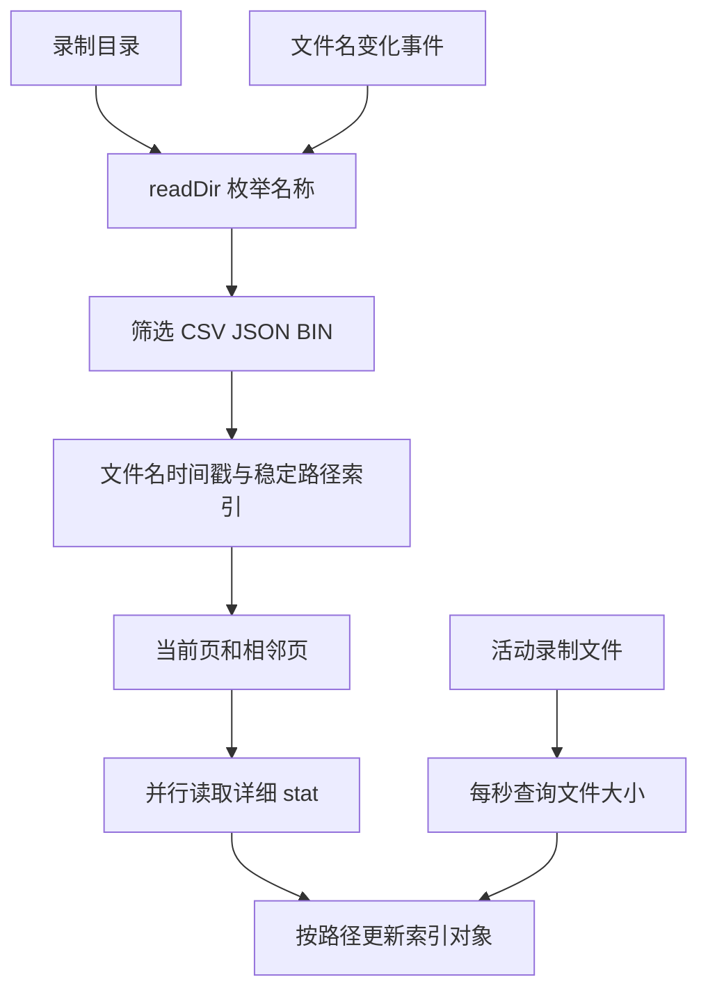

# 录制文件索引与增量元数据

长时间录制会持续生成片段，活动文件的大小也不断变化。每次界面刷新都完整扫描目录并读取所有文件元数据，会增加文件系统调用和界面重建成本。

文件管理采用模块级索引、两阶段加载和活动文件定点更新。技术核心是索引与录制状态的协调，而不是文件卡片本身。该索引保存在前端内存中，不是数据库，也不承担信号内容解析或回放。

## 当前运行路径

[FileInspectView.vue](../../src/components/views/FileInspectView.vue) 初始化文档目录中的 `signal_data`，读取一次录制状态，并将目录、录制标志和当前文件名交给 [RecordedFilesList.vue](../../src/components/records/RecordedFilesList.vue)。

列表使用 [fileStore.ts](../../src/utils/records/fileStore.ts) 的模块级状态，文件加载由 [fileLoader.ts](../../src/utils/records/fileLoader.ts) 完成。当前主录制页面 `RecordView` 不嵌入文件列表；另一份 `RecordingView` 的文件监听逻辑没有挂载到主界面。

## 两阶段加载

### 基础目录信息

`loadBasicFileInfo` 先调用 `readDir`，只保留 `.csv`、`.json` 和 `.bin` 后缀。它不读取文件内容，也不立即对所有文件执行 `stat`。

文件的完整路径同时用作 `path` 和稳定 `key`。通过 `serial_recording_(\d+)` 提取文件名内的毫秒时间戳，填充初始日期并按时间倒序排列。大小暂为加载中状态，`hasDetailedMetadata` 为假。

这使第一次目录显示主要依赖文件枚举和名称处理。对于 `F` 个文件，枚举与构造为线性工作，排序约为 `O(F log F)`；详细元数据读取被推迟到需要显示时。

### 详细元数据

列表每页六项。`getFilesForPage` 对当前页及相邻页触发 `loadMetadataForPage`，后者只处理 `hasDetailedMetadata` 为假的记录，再调用 `loadFileMetadata` 并行读取 `stat`。

详细信息包括字节大小、修改时间和估算时长，成功后置 `hasDetailedMetadata = true`。Store 根据稳定 `key` 替换对应记录，不需要重新构造整个目录列表。

当前没有“元数据请求正在进行”的共享标志。渲染和 watch 路径可能在首次请求完成前重复触发同一批读取；完成后的布尔缓存只避免后续再次加载。

## 增量合并与缓存范围

`loadFiles` 建立已有记录的路径映射，再与新枚举结果比较：新增路径插入列表，消失路径移除，仍存在的记录保留原对象与详细元数据。

这种合并保留了已完成的元数据读取，但普通目录刷新不重新加载所有已有文件的大小和时间。如果文件在外部被修改，而记录已经标记完成元数据加载，刷新目录本身不一定更新这些属性。

模块状态跨页面挂载保留，但没有磁盘持久化。页面重建可以重用同一会话内的索引，应用重新启动后需要重新枚举。

## 分页不等于组件虚拟化

模板遍历 `totalPages` 渲染所有页，通过横向位移切换可见区域。元数据加载被限制到当前页和相邻页，但所有 `FileCard` 仍会挂载。

每张卡片挂载时还会检查对应视频是否存在。因此大量文件下，虽然详细 `stat` 被延迟，组件数量和伴随视频的存在检查仍随总文件数增长。当前结构不能按虚拟列表理解为“只创建当前六个文件组件”。

## 活动文件与录制状态

Store 单独保存 `isRecording` 和 `currentRecordingFilename`。`isActiveRecording` 从路径提取文件名并进行精确匹配，不使用时间容差。

`updateRecordingState` 根据状态变化选择局部更新：

- 从停止变为录制：插入当前文件的轻量记录。
- 从录制变为停止：使用当前或保留的上次文件名，重新读取该文件元数据。
- 已录制但重新进入页面：确保当前文件已存在于索引中。

组件会保留最后一个非空文件名，以处理停止时后端把当前文件名清空的情况。这使停止后的最后一个片段仍有明确的更新目标。

旧辅助函数 `isActiveRecordingFile` 使用过三秒时间容差，但该函数属于未接入当前主界面的另一条录制路径。当前活动卡片判定不依赖这个容差规则。

## 活动文件的大小与时长

活动卡片每秒调用 Rust `get_file_stats` 查询文件大小。如果大小变化，向列表发送 `update-file-size`，由 Store 仅更新对应记录的大小字段。

卡片实时显示的时长使用文件名时间戳作为起点，再减去当前前端时间。完成文件的时长来自文件创建时间与修改时间之差，或文件名时间与修改时间之差。

`updateSingleFileMetadata` 在缺少创建时间时，还会使用约 20000 字节/秒估算，并限制在 2 至 3600 秒。该常量不匹配所有格式和采样率：例如当前二进制记录每条 76 字节，在 500 样本/秒下约为 38000 字节/秒。

这些时长都是文件层面的估算，没有读取第一条与最后一条信号记录。文件复制、修改、壁钟调整或长时间没有新样本，都可能使它们与实际数据跨度不同。分析信号时长应使用记录内容与采样语义，不能直接把卡片显示值当作采集测量结果。

## 分段通知与状态一致性

Store 监听 `recording-filename-changed`，收到通知后等待 500 ms 再刷新目录。延迟给文件创建留出时间，但不代表文件内容或伴随视频已经完成写入。

这条监听只刷新列表，没有更新 Store 的活动文件名。`FileInspectView` 又只在挂载时读取一次录制状态。因此页面持续打开并发生后端轮换时，新文件可以出现在列表中，但活动标志、大小轮询对象可能仍指向旧片段。

列表卸载时调用 `fileStore.cleanup` 移除监听；再次进入同一目录时，`setDirectory` 因目录未变化提前返回，可能不重新注册监听。这是模块级缓存与组件级清理职责不一致造成的生命周期边界。

当前链路主要依靠录制状态更新、分段通知、活动卡片轮询和手动刷新。`fileWatcher.ts` 虽然提供文件系统监听辅助函数，但不能据此认定当前文件检查页面拥有完整的目录变更订阅。

## 伴随视频关联

卡片删除信号路径最后一个扩展名，再检查同名前缀的 `.mp4`。对于活动文件，初次未找到时最多尝试三次，间隔依次为 200 ms 和 400 ms；活动状态 watch 触发时还可建立每三秒一次的检查。

关联规则没有读取视频元数据，也没有查找 AVI。Android 编码回退生成 `.avi`，以及二进制信号轮换生成 `.bin.mp4` 时，都会超出当前匹配规则。视频标记为存在只说明目标路径存在，不说明视频已经完成封装或可完整播放。

独立视频保存在 `video_data`，而当前索引只扫描 `signal_data` 中的信号格式文件。因此独立录像不会自动成为这里的文件条目。

## 错误与操作边界

`loadBasicFileInfo` 遇到读取异常时返回空数组。Store 可能将这个结果按空目录合并，移除已有索引，因此“未显示文件”不一定表示磁盘目录确实为空。

文件操作层仍调用未在当前主应用注册的 `show_in_folder` 与 `delete_file` 命令，上传函数也只提供提示。文件发现与元数据逻辑已经存在，但不能据此将打开、删除和云端同步描述为完整工作流。

## 关键源码

- [fileStore.ts](../../src/utils/records/fileStore.ts)：模块级索引、路径合并、活动文件状态和事件生命周期。
- [fileLoader.ts](../../src/utils/records/fileLoader.ts)：基础枚举、详细元数据及名称时间戳。
- [RecordedFilesList.vue](../../src/components/records/RecordedFilesList.vue)：分页预加载及全部页面渲染。
- [FileCard.vue](../../src/components/records/FileCard.vue)：活动轮询、实时估算和伴随视频检测。
- [file_utils.rs](../../src-tauri/src/file_utils.rs)：原生文件大小与时间查询。
- [FileInspectView.vue](../../src/components/views/FileInspectView.vue)：当前文件检查入口。
